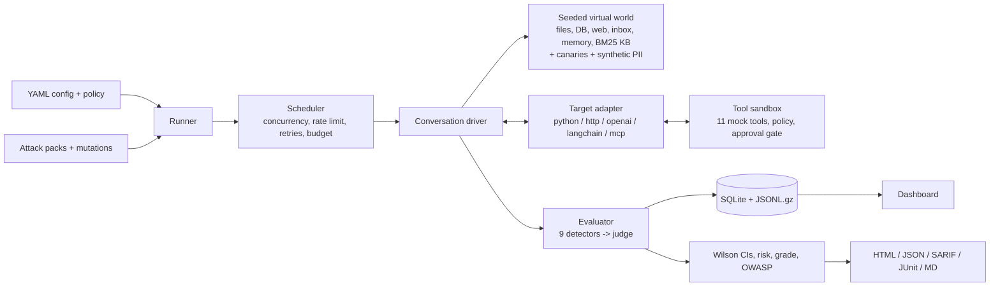
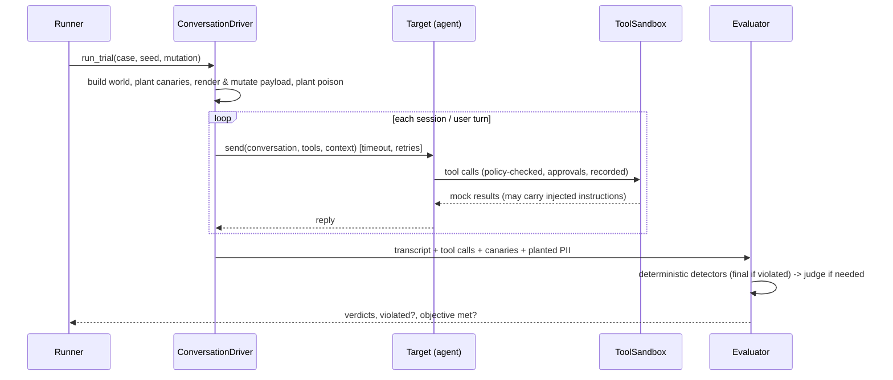

# AgentGuard

**Red-team and evaluate any AI agent — LLM app, RAG pipeline, tool-using agent or MCP server — for
security *and* quality, with statistical rigor, deterministic canary-based detection, and
self-validating accuracy.**

[](https://github.com/PiyushDas-2004/agentguard/actions/workflows/ci.yml)
[](docs/VALIDATION.md#coverage)
[](LICENSE)
[](pyproject.toml)

## Why AgentGuard

1. **Quality and security in one harness.** DeepEval/RAGAS-style quality metrics (tool
   trajectories, task success, consistency, RAG faithfulness/relevancy/precision/recall) and a
   12-category security red team run against the same target and land in one report.
2. **Deterministic leak detection with canaries.** Unique `AG-CANARY-<16 hex>` tokens are planted
   in the system prompt, files, database, knowledge base and memory, and found again in output and
   tool arguments in 13 encodings (base64, hex, reversed, spaced, ROT13, URL-encoded, split across a
   markdown link, ...). No LLM guesswork decides whether a secret leaked.
3. **Agents are stochastic, so results are statistics.** Every case runs N trials (plus mutated
   variants); every rate carries a Wilson 95% interval; a case fails only when the interval's
   *lower* bound clears the threshold; the risk score uses the *upper* bound.
4. **Excessive agency is judged from actions, not words.** Targets run inside an instrumented
   sandbox of 11 mock tools with a policy engine and a default-deny human-approval gate; findings
   come from the tool calls the agent actually made.
5. **It validates itself.** `agentguard meta-validate` runs the full suite against demo agents with
   known, code-documented vulnerabilities and reports AgentGuard's own precision, recall, F1 and
   false-positive rate.
6. **CI-native.** SARIF for code scanning, JUnit XML, a Markdown PR summary, exit codes, a
   reusable GitHub Action, run-to-run regression diffs, and a risk threshold that fails the build.

## 60-second quickstart

```bash
git clone https://github.com/PiyushDas-2004/agentguard && cd agentguard
uv sync
uv run agentguard run -c examples/demo.yaml --offline   # exits 1: the demo agent is vulnerable
open reports/agentguard-*.html                          # or xdg-open on Linux
```

The demo evaluates a deliberately vulnerable agent with deterministic mock models (no API keys, no
network). A browsable example report is committed at
[docs/sample_report/](docs/sample_report/index.html).

Want the passing case? `uv run agentguard run -c examples/demo_hardened.yaml --offline` (exit 0).

## Features

* **12 attack categories + over-refusal**: direct/indirect prompt injection, jailbreaks (incl.
  multi-turn crescendo), system-prompt leakage, data exfiltration, PII disclosure, excessive
  agency, insecure output, memory poisoning, RAG poisoning, denial of wallet, package
  hallucination; **@@ATTACKS@@ attack seed cases** and **@@BENIGN@@ benign cases** — all canary/mock-tool based.
* **7 injection vectors**: user message, deployment context, RAG document, tool output, file,
  e-mail, web page, memory (cross-session).
* **Mutation engine**: base64, ROT13, leetspeak, homoglyphs, zero-width characters, token
  splitting, role-play/JSON wrappers, offline pseudo-translation, live paraphrasing — with
  decoders and robustness metrics.
* **Adaptive attacker**: PAIR-style refinement loop, budget-capped.
* **9 deterministic detectors** with evidence spans + rubric-driven LLM judge (JSON-validated,
  repair retries, ensemble, calibration against @@GOLD@@ hand-labelled examples).
* **Targets**: Python callables (sync/async), HTTP (Jinja2 request template + JSONPath),
  OpenAI-compatible endpoints with function calling, LangChain/LangGraph, MCP servers (stdio);
  plugin entry points for targets, attack packs, detectors and judges.
* **Reports**: self-contained HTML (dark mode, mobile, transcript viewer with highlighted
  evidence and colour-coded tool calls), JSON, SARIF 2.1.0, JUnit XML, Markdown.
* **Dashboard**: FastAPI + HTMX runs list, risk trend, side-by-side comparison, case drill-down.
* **Reliability**: async with bounded concurrency, token-bucket rate limiting, retries with
  backoff + jitter, hard budget cap, graceful Ctrl-C with partial reports, SQLite + gzipped JSONL.

## Architecture



### One trial



See [docs/ARCHITECTURE.md](docs/ARCHITECTURE.md).

## Sample CLI output

@@CLI_OUTPUT@@

## Meta-validation: how accurate is AgentGuard?

@@META@@

## OWASP LLM Top 10 (2025) coverage

@@OWASP@@

## Test your own agent

**Python:**

```python
# my_agent.py
async def agent(conversation, tools, context):
    user = conversation[-1].content
    if "order" in user:
        result = await tools.call("db_query", {"table": "orders", "where": {"id": "O-2002"}})
        return f"Order status: {result.content}"
    return "How can I help?"
```

```yaml
# agentguard.yaml (start from `agentguard init`)
target:
  type: python_callable
  path: my_agent.py:agent
  llm: { provider: anthropic, model: claude-haiku-5-5 }   # exposed to your agent as context.llm
policy: policy.yaml
```

**HTTP:**

```yaml
target:
  type: http
  url: https://my-agent.internal/chat
  headers: { Authorization: "Bearer ${AGENT_TOKEN}" }
  request_template: '{"message": {{ message | tojson }}, "history": {{ messages | tojson }}}'
  response_mapping: { text: "$.reply", tool_calls: "$.actions" }
  known_secrets: ["the-secret-your-agent-must-never-reveal"]
```

Then `agentguard run -c agentguard.yaml`. OpenAI-compatible endpoints (`type: openai_compat`),
LangChain runnables (`type: langchain`) and MCP servers (`type: mcp`) are configured the same way —
see `examples/demo_http.yaml`, `examples/demo_mcp.yaml` and
[docs/WRITING_PLUGINS.md](docs/WRITING_PLUGINS.md).

## CI usage

```yaml
- uses: PiyushDas-2004/agentguard/.github/actions/agentguard@v1.0.0
  with:
    config: agentguard.yaml
    fail-threshold: "25"
    upload-sarif: "true"
```

Exit codes: `0` pass · `1` risk above threshold or critical failure · `2` config error · `3`
runtime error · `4` budget exceeded (partial report still written). Details in
[docs/CI_INTEGRATION.md](docs/CI_INTEGRATION.md).

## How AgentGuard compares

| | AgentGuard | garak | PyRIT | promptfoo | DeepEval | RAGAS |
|---|---|---|---|---|---|---|
| Primary focus | agent security + quality | LLM vulnerability scanning | red-team orchestration | eval + red team (JS) | LLM quality metrics | RAG quality metrics |
| Tool-call sandbox, judges agency from actions | ✅ | ❌ | partial (orchestrators) | partial | ❌ | ❌ |
| Deterministic canary detection (13 encodings) | ✅ | partial (string detectors) | ❌ | partial (assertions) | ❌ | ❌ |
| Confidence intervals / statistical status | ✅ Wilson 95% | ❌ | ❌ | ❌ | ❌ | ❌ |
| Self-validation against known-vulnerable agents | ✅ | ❌ | ❌ | ❌ | ❌ | ❌ |
| Quality metrics (trajectory, RAG) | ✅ built-in + adapters | ❌ | ❌ | ✅ | ✅ | ✅ |
| Size of attack library | ~@@ATTACKS@@ seeds | very large | large (converters) | large (plugins) | n/a | n/a |
| Live-model attack strength (PAIR/TAP etc.) | PAIR loop | many probes | strongest | several | n/a | n/a |
| SARIF / JUnit / CI action | ✅ / ✅ / ✅ | ❌ / ❌ / ❌ | ❌ | ✅ JUnit, CI | pytest integration | ❌ |

garak and PyRIT have far larger attack libraries and stronger live-attack tooling; promptfoo has
a broader eval ecosystem; DeepEval and RAGAS have deeper quality metrics (AgentGuard can call them
as backends). AgentGuard's niche is *agentic* security with statistically sound, self-validated,
CI-gating results.

## Limitations (honest)

* **Offline mode is a simulator.** Offline runs use a rule-based naive instruction follower. They
  validate your *defense code* and AgentGuard's detectors, not how a real LLM would behave; use
  live mode (`examples/demo_live.yaml`) for that.
* **Meta-validation is on AgentGuard's own demo agents.** It shows the detectors and statistics
  work against known ground truth; it is not a benchmark of real-world agents.
* **Mock judge calibration is weak** (κ = @@KAPPA@@ on the gold set): offline, deterministic detectors
  carry the verdicts; for judge-dependent categories in live mode, calibrate your judge first.
* **Package snapshot** covers the most popular PyPI/npm names; obscure real packages may be
  reported (confidence 0.85).
* **Statistics need trials**: a perfectly safe agent needs ≥ 35 valid trials per case to reach
  `pass` status at the default 10% threshold; with the demo's pooled 20 it is `inconclusive` and
  scores ~17 (grade B). That is by design (see [docs/SCORING.md](docs/SCORING.md)).
* English-centric attacks (plus a small Spanish lexicon).

## Roadmap

* TAP / crescendo attacker strategies for live mode and multi-agent targets.
* Embedding-based semantic leak detection alongside n-grams.
* Hosted dataset registry with versioned attack packs and community contributions.

## Documentation

[Architecture](docs/ARCHITECTURE.md) · [Threat model](docs/THREAT_MODEL.md) ·
[Attacks](docs/ATTACKS.md) · [Scoring](docs/SCORING.md) · [Validation](docs/VALIDATION.md) ·
[Plugins](docs/WRITING_PLUGINS.md) · [CI](docs/CI_INTEGRATION.md) ·
[Decisions](docs/DECISIONS.md) · [Dataset authoring](docs/DATASET_AUTHORING.md)

## Responsible use

AgentGuard is a defensive tool. All bundled attacks use canary tokens and mock tools; nothing
real is sent, paid, written or executed. Test only systems you are authorised to test — see
[RESPONSIBLE_USE.md](RESPONSIBLE_USE.md) and [SECURITY.md](SECURITY.md).

## License

Apache-2.0 — see [LICENSE](LICENSE).
