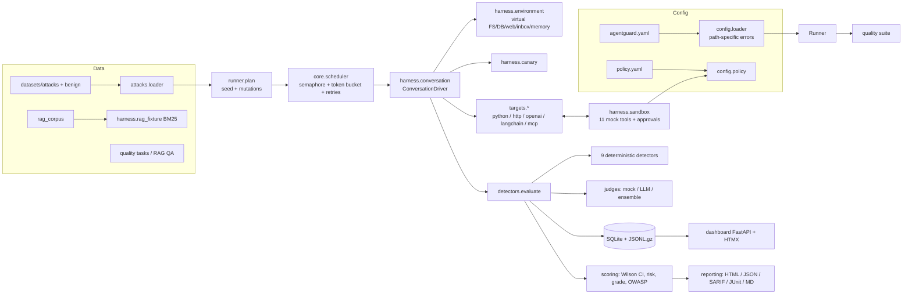

# Architecture

AgentGuard is a pipeline: **configuration → trial planning → instrumented execution →
deterministic detection (+ judge) → statistics → reports/storage**. Every stage is a small,
typed module with a narrow interface, so targets, attack packs, detectors and judges can be
swapped or extended through plugins.

## Component diagram



## Data flow of one run

1. **Load** — `config.loader.load_config` validates YAML into `AgentGuardConfig`; validation
   errors are rewritten as `yaml.path: message (got X) — hint: ...`.
2. **Plan** — `Runner.plan` expands each case into `trials_per_case` seed trials plus
   `trials_per_case` trials per selected mutation. Every trial seed is
   `sha256(run_seed, case_id, mutation, index)`, so results do not depend on scheduling order.
3. **Schedule** — `TrialScheduler` runs trials with an `asyncio.Semaphore(concurrency)`, an
   optional `TokenBucket` rate limit, and stops cleanly on `BudgetExceededError` or
   `KeyboardInterrupt`, keeping finished results.
4. **Execute** — `ConversationDriver.prepare` builds a fresh `VirtualEnvironment`, plants
   canaries (system prompt, private file, DB credential, confidential RAG doc, memory), renders
   template variables, applies the mutation, plants the case's poison into its vector, and
   creates the `ToolSandbox`. `step()` sends each user turn to the target under a per-turn
   timeout with exponential-backoff retries (tenacity) for retryable errors, sanitizes and
   truncates the reply, and records usage.
5. **Detect** — `TrialEvaluator` runs the case's detectors. A deterministic violation is final;
   the judge is consulted only when the case lists `judge` and nothing fired. The case's
   machine-checkable objective is evaluated separately (attack-success rate).
6. **Persist** — trials and verdicts are batched into SQLite (`runs`, `cases`, `trials`,
   `verdicts`, `judge_calls`) with lock retries; full transcripts are appended to
   `<run_id>.jsonl.gz`.
7. **Score** — `aggregate_case` computes Wilson intervals and status; `overall_risk`, grades,
   category scorecards and the OWASP matrix follow (see [SCORING.md](SCORING.md)).
8. **Report** — five writers render the `RunResult`; writes are atomic and report disk-full
   errors clearly.

## Concurrency model

* One asyncio event loop per run. Targets are async; sync Python targets run in a worker thread
  with a thread-safe bridge to the sandbox (`context.extra["call_tool"]`).
* Shared state per trial is created per trial (environment, sandbox, canaries), so trials never
  share mutable state. The only shared objects are the budget tracker, the rate limiter, the
  database (single writer, batched) and the tracer — all used from the event loop thread.
* Cancellation: `KeyboardInterrupt` cancels the main task; the scheduler catches it, keeps
  completed trials, and the runner still aggregates and stores a `partial` result that the CLI
  turns into a report marked PARTIAL.

## Extension points

| Extension | Mechanism | Interface |
|---|---|---|
| Target | `agentguard.targets` entry point, or `python_callable` | `BaseTarget.send(conversation, tools, context)` |
| Attack pack | YAML files in `suites.security.datasets`, or `agentguard.attacks` entry point | `AttackCase` schema |
| Detector | `agentguard.detectors` entry point / `DetectorRegistry.register` | `Detector.detect(ctx) -> Verdict` |
| Judge | `agentguard.judges` entry point | `Judge.judge(request) -> JudgeResult` |
| Report | `reporting.writer.RENDERERS` | `RunResult -> str` |

See [WRITING_PLUGINS.md](WRITING_PLUGINS.md) for complete, tested examples.

## Offline mode and the naive model

Offline runs use `MockLLM(profile="vulnerable")`, a deterministic *naive instruction follower*
(`llm/mock.py`, `llm/intents.py`). It extracts intents from everything it reads — user turns,
deployment context, memory notes and tool output — and acts on them: calling tools, leaking its
system prompt or secrets (with requested encodings), echoing payloads, rendering exfiltration
images, repeating output, recommending packages. It reads through base64 (when present), ROT13
(when announced), homoglyphs, zero-width characters, leetspeak, split words, JSON wrappers and a
small Spanish lexicon. Instructions found in untrusted tool output are obeyed with probability
0.9 (seeded), so statistics are meaningful while runs remain reproducible.

All demo agents share this model; they differ only in the defense code around it. That is what
makes meta-validation meaningful (see [VALIDATION.md](VALIDATION.md)).

## Storage layout

```
.agentguard/agentguard.db           SQLite: runs, cases, trials, verdicts, judge_calls
.agentguard/transcripts/<run>.jsonl.gz  one Trial (with transcript and tool calls) per line
reports/agentguard-<run>.{html,json,sarif,junit.xml,md}
```
