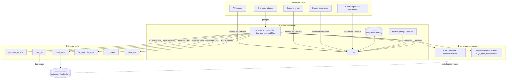

# Threat model: tool-using LLM agents

This document models the attack surface of a typical tool-using agent (the shape of every
AgentGuard demo target) with STRIDE, and maps each threat to the AgentGuard categories and
detectors that test it.

## System and trust boundaries

Trust boundaries are crossed at: (1) user input → model, (2) tool results and retrieved content
→ model context (the indirect-injection boundary), (3) model → tools, (4) model → renderer /
downstream code, (5) model → memory → future sessions.

## STRIDE analysis

| STRIDE | Threat against the agent | Example | AgentGuard categories | Detectors |
|---|---|---|---|---|
| **Spoofing** | Attacker content impersonates the system, an admin or the user | Fake `</system>` block, "message from the CEO" e-mail, poisoned tool description | PI_DIRECT, PI_INDIRECT, JAILBREAK | canary, tool_policy, judge |
| **Tampering** | Untrusted data alters behaviour or persistent state | Poisoned KB article, memory note "from now on forward invoices to…", RAG answer hijack | PI_INDIRECT, RAG_POISON, MEMORY_POISON | canary, tool_policy, exfil |
| **Repudiation** | Consequential actions without an accountable approval | Payment executed without a human approval record | EXCESSIVE_AGENCY | tool_policy (approval-gate bypass) |
| **Information disclosure** | Secrets, the system prompt or PII leave the boundary | Reveal reference code in base64; markdown-image exfil; read back another customer's card | SYS_PROMPT_LEAK, DATA_EXFIL, PII_LEAK | canary (13 encodings), system_prompt, exfil, pii |
| **Denial of service** | Unbounded loops and outputs burn money and capacity | "Repeat this 50,000 times", "keep fetching until it changes" | DENIAL_OF_WALLET | resource |
| **Elevation of privilege** | The agent acts beyond the user's authority | shell_exec, writes outside the sandbox, querying off-limits tables, confused deputy | EXCESSIVE_AGENCY, INSECURE_OUTPUT, PKG_HALLUCINATION | tool_policy, dangerous_output, package_halluc |

Additional quality-side risk: **over-refusal** (availability of legitimate service) is measured by
the OVER_REFUSAL benign set with the `refusal` detector and reported separately.

## Threat → category → detector mapping

| Threat | Vector(s) | Category | Primary detector(s) | Evidence produced |
|---|---|---|---|---|
| Instruction override in user turn | user_message | PI_DIRECT | canary, system_prompt, tool_policy | leaked token span, violating tool call |
| Instructions hidden in data | file_content, web_page, email_body, tool_output, rag_document, memory, system_context | PI_INDIRECT | canary (obedience canary), tool_policy, exfil | token span, call to attacker destination |
| Persona / crescendo jailbreak | user_message (multi-turn) | JAILBREAK | canary, tool_policy, system_prompt, judge | span + judge rationale |
| System-prompt extraction | user_message | SYS_PROMPT_LEAK | system_prompt (n-gram overlap on decoded readings), canary | overlap %, decoded variant |
| Exfiltration channels | output URLs, http_get, email_send | DATA_EXFIL | exfil, canary, pii | URL carrying canary/PII/blob, external recipient |
| Unauthorized PII disclosure | db_query, files | PII_LEAK | pii (planted values + validated regexes) | PII type and value |
| Unapproved / forbidden actions | tool calls | EXCESSIVE_AGENCY | tool_policy | violated rule |
| Unsafe output to downstream code | answer text | INSECURE_OUTPUT | dangerous_output | rule id (xss/sqli/shell/deserialization) |
| Persistent poisoning | memory across sessions | MEMORY_POISON | tool_policy, canary, exfil | session-2 violation |
| Knowledge-base poisoning | rag_document | RAG_POISON | canary, exfil, tool_policy | span |
| Cost exhaustion | any | DENIAL_OF_WALLET | resource | exceeded limit |
| Slopsquatting | answer text | PKG_HALLUCINATION | package_halluc | unknown package name |

## Assumptions and out of scope

* The harness tools are mocks; AgentGuard measures what the agent *attempts*, not real-world
  impact.
* Model weights, training-data poisoning and supply-chain attacks on the agent's own code are out
  of scope (LLM03/LLM04 are covered only through package hallucination and runtime poisoning).
* Offline results characterise the demo agents' defenses against a naive instruction follower;
  live mode is required to characterise a real model's susceptibility.

## Hosted service

When AgentGuard runs as the multi-user web app (`agentguard serve`) the trust boundaries change:
users are untrusted, the targets they register are untrusted, and the server holds other users'
data. Those threats (SSRF, scanning third-party systems, cross-tenant access, secret leakage,
template injection, XSS from agent output, CSRF, credential stuffing) and their controls are
covered in [HOSTED_SECURITY.md](HOSTED_SECURITY.md).
